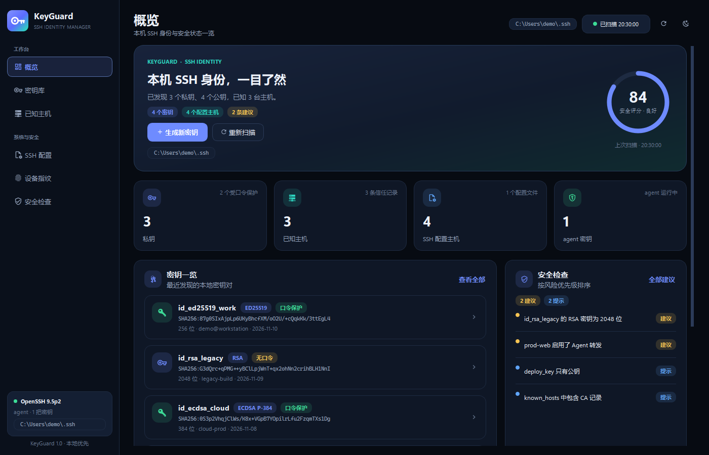
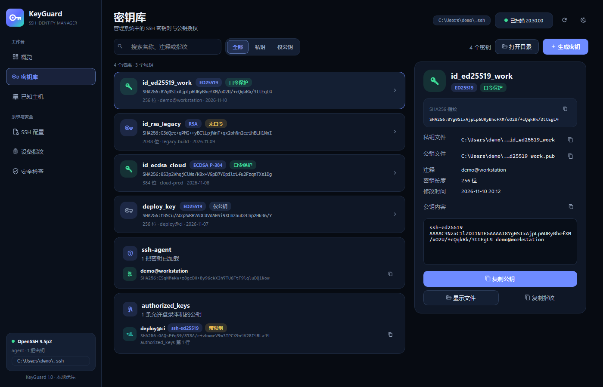
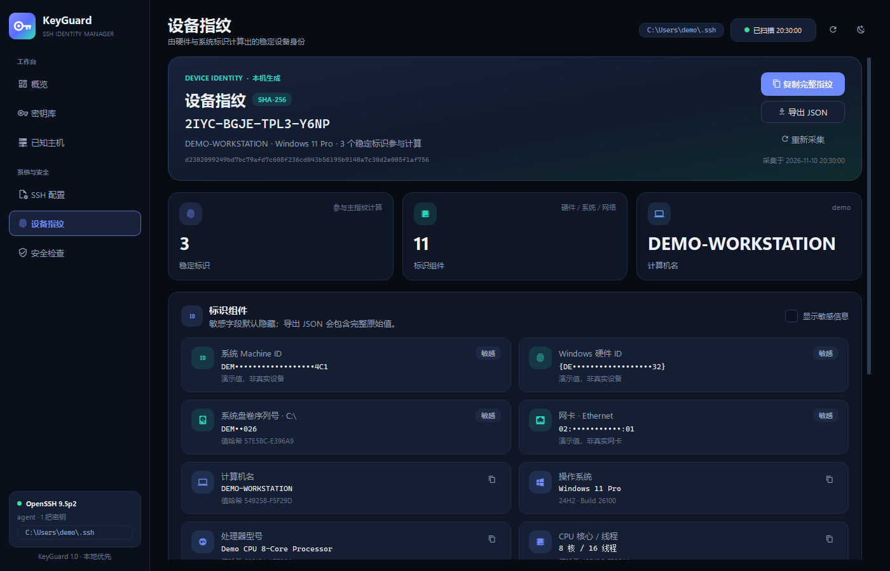
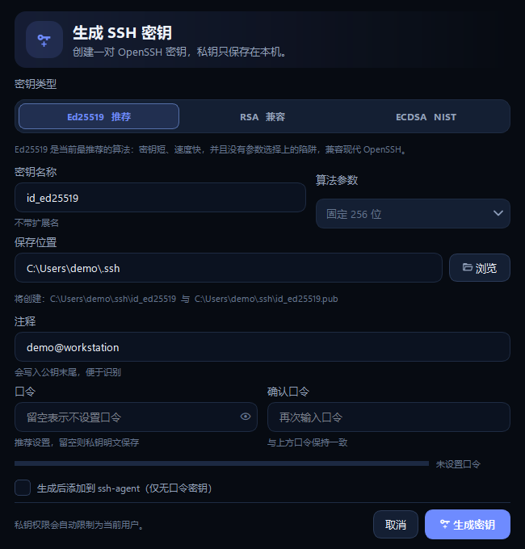
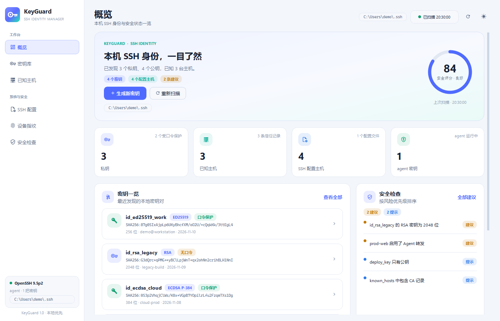

# KeyGuard

> 本地优先的 SSH 密钥与设备指纹管理器，使用 Python + PySide6 构建。

[](https://github.com/Almost-Noob/KeyGuard/actions/workflows/tests.yml)
[](LICENSE)
[](https://www.python.org/)
[]()

KeyGuard 把本机 SSH 身份、信任关系、设备标识和安全风险集中到一个现代桌面界面中。所有扫描、指纹计算和密钥生成都在本地完成，不上传密钥、指纹或扫描结果。



## 功能

- **主动扫描系统 SSH 状态**：读取 `~/.ssh` 下的私钥、公钥、SSH 证书、`known_hosts`、`authorized_keys` 和 `config`
- **OpenSSH 环境识别**：客户端版本、`ssh-agent` 服务状态、本机 `sshd` 状态
- **密钥分析**：SHA256 / MD5 指纹、算法、位数、口令保护、公私钥是否匹配、证书有效期、私钥 ACL 权限
- **密钥生成**：Ed25519 / RSA / ECDSA，支持口令、注释、自定义目录、自动生成 `.pub`、限制私钥权限、加载到 ssh-agent
- **设备指纹**：Machine ID、Windows 硬件 ID、系统盘序列号等稳定标识，SHA-256 主指纹、组件哈希、敏感信息遮罩
- **安全审计**：弱算法、权限过宽、重复密钥、过期证书、known_hosts 撤销记录、高风险 SSH 配置、sshd 配置
- **现代 UI**：深色/浅色主题、搜索、筛选、复制、Toast 提示、JSON 导出、键盘快捷键

## 界面

| 密钥库 | 设备指纹 |
| --- | --- |
|  |  |

| 生成密钥 | 浅色主题 |
| --- | --- |
|  |  |

> 截图使用 `tools/demo_screenshots.py` 生成的合成演示数据，不包含真实密钥、主机名或硬件标识。

## 快速开始

### 环境要求

- Python **3.11+**（开发环境使用 3.15）
- Windows 10/11（完整功能的主要目标平台）
- 可选：OpenSSH 客户端（Windows 通常已内置），用于读取版本、`ssh-agent` 和 `sshd` 状态

### Windows

```powershell
git clone https://github.com/Almost-Noob/KeyGuard.git
cd KeyGuard

python -m venv .venv
.\.venv\Scripts\python.exe -m pip install -r requirements.txt

.\run.cmd
```

也可以直接运行：

```powershell
.\.venv\Scripts\python.exe main.py
```

**不需要先激活虚拟环境**。`run.cmd` 直接调用 `.venv` 解释器，因此不会触发 PowerShell 对 `Activate.ps1` 的执行策略检查。

### Linux / macOS

```bash
git clone https://github.com/Almost-Noob/KeyGuard.git
cd KeyGuard
python3 -m venv .venv
. .venv/bin/activate
python -m pip install -r requirements.txt
python main.py
```

### 命令参数

```text
--ssh-dir PATH     指定要扫描的 SSH 目录（默认 ~/.ssh）
--theme dark|light 指定主题
```

示例：

```powershell
.\.venv\Scripts\python.exe main.py --ssh-dir C:\Users\demo\.ssh --theme light
```

## 使用说明

### 密钥库

- 左侧列出发现的密钥对和仅公钥文件，右侧展示指纹、路径、注释和公钥内容
- “复制公钥”可直接粘贴到 GitHub / GitLab / 服务器 `authorized_keys`
- 私钥内容不会显示在界面上
- 生成密钥时推荐 Ed25519；需要兼容旧系统时选择 RSA 3072+
- 无口令密钥可以勾选“生成后添加到 ssh-agent”；有口令密钥需要手动执行 `ssh-add`

### 已知主机

- 展示 `known_hosts` 中的服务器主机密钥、类型、指纹和标记
- `@revoked`（已撤销）和 `@cert-authority`（CA）会单独标识
- 点击复制按钮可以复制主机指纹

### SSH 配置

- 解析 `~/.ssh/config` 中的 `Host`、`HostName`、`User`、`Port`、`IdentityFile`、`ProxyJump` 等
- 支持 `Include`
- 可查看原始配置文本

### 设备指纹

- 从稳定硬件标识计算 SHA-256 主指纹
- 默认遮罩敏感字段，勾选“显示敏感信息”后可查看和复制
- 可导出包含原始标识的 JSON；导出文件属于敏感数据

### 安全检查

| 等级 | 示例 |
| --- | --- |
| 严重 | DSA 密钥、已知主机密钥被撤销、公私钥不匹配 |
| 建议 | 私钥无口令、私钥权限过宽、RSA 小于 3072 位、危险 SSH 配置 |
| 提示 | 仅有公钥、agent 未运行、证书尚未生效 |

评分公式：`100 - 严重 × 24 - 建议 × 8`，最低 8 分。

## 工作原理

```text
~/.ssh ──> SSH scanner ──> KeyRecord / KnownHost / HostConfig / Finding
                │
                ├── OpenSSH wire format parser（指纹、位数、证书）
                ├── Private key header parser（算法、是否加密）
                └── Audit rules ──> score / grade

Windows registry / CIM / volume info ──> DeviceFingerprint ──> SHA-256 device_id
```

核心实现：

- [app/core/ssh.py](app/core/ssh.py)：扫描、公钥/私钥解析、known_hosts、SSH config、authorized_keys、审计、密钥生成
- [app/core/device.py](app/core/device.py)：设备标识采集、注册表兜底、稳定指纹计算
- [app/ui/](app/ui/)：PySide6 界面、页面、主题和组件

更详细的设计说明见 [docs/DEVELOPMENT.md](docs/DEVELOPMENT.md)。

## 安全与隐私

- 所有数据仅在本机处理，没有遥测、云端同步或网络上传
- 私钥内容不会渲染到 UI，只读取结构以计算公钥和指纹
- 设备指纹默认遮罩敏感字段；导出的 JSON 包含原始硬件标识
- 生成密钥后尝试在 Windows 上把私钥 ACL 限制为当前用户、SYSTEM 和 Administrators
- 不要把真实私钥、导出指纹或 `.ssh` 目录提交到仓库

更多内容见 [SECURITY.md](SECURITY.md)。

## 项目结构

```text
.
├── main.py                     # 应用入口
├── app/
│   ├── core/
│   │   ├── ssh.py              # SSH 扫描、解析、审计、密钥生成
│   │   └── device.py           # 设备指纹采集
│   └── ui/
│       ├── main_window.py      # 主窗口、导航、扫描调度
│       ├── theme.py            # 设计令牌、QSS、深色/浅色主题
│       ├── widgets.py          # 通用 UI 组件
│       ├── dialogs.py          # 生成密钥对话框
│       └── pages/              # 概览、密钥库、已知主机、配置、指纹、审计
├── assets/                     # Logo、图标资源
├── docs/                       # 开发文档与截图
├── tests/                      # 单元测试 + UI smoke tests
├── tools/demo_screenshots.py   # 合成演示数据截图生成器
├── requirements.txt
├── run.cmd                     # Windows 启动器（不依赖 PowerShell 激活）
└── run.ps1
```

## 开发

```powershell
.\.venv\Scripts\python.exe -m pip install -r requirements.txt
.\.venv\Scripts\python.exe -m unittest discover -s tests -q
```

运行 UI 测试时建议使用 offscreen 平台：

```powershell
$env:QT_QPA_PLATFORM = "offscreen"
.\.venv\Scripts\python.exe -m unittest discover -s tests -v
```

代码风格：Python 3.11+、类型标注、4 空格缩进、UI 与 core 解耦。更多开发约定见 [docs/DEVELOPMENT.md](docs/DEVELOPMENT.md)。

## 已知限制

- Windows 的私钥 ACL 修复依赖 `icacls`；非 Windows 平台使用 `chmod 600`
- `known_hosts` 中的哈希主机名无法还原为明文
- SSH 证书解析覆盖公开字段和有效期，不验证 CA 链
- 本应用不删除密钥文件，避免误操作
- 设备指纹不是硬件级 TPM 证明，重装系统或更换硬件后可能变化

## 常见问题

### VS Code 报 `Activate.ps1` 未签名

这是 PowerShell 执行策略拦截虚拟环境激活，不是应用错误。直接运行：

```powershell
.\run.cmd
```

或在当前 PowerShell 会话临时放开：

```powershell
Set-ExecutionPolicy -Scope Process -ExecutionPolicy Bypass
& .\.venv\Scripts\Activate.ps1
```

### GitHub 报 `Permission denied (publickey)`

确认：

1. 公钥已添加到 GitHub：<https://github.com/settings/keys>
2. `~/.ssh/config` 为 `github.com` 指定了正确的 `IdentityFile`
3. `ssh -T git@github.com` 显示 `successfully authenticated`

如果 Git for Windows 使用自带的 `ssh.exe`，它可能看不到 Windows `ssh-agent` 中的密钥；在 `~/.ssh/config` 中显式指定 `IdentityFile` 可以同时兼容两套客户端。

### `ssh-agent` 未运行

Windows 管理员 PowerShell：

```powershell
Set-Service ssh-agent -StartupType Automatic
Start-Service ssh-agent
ssh-add $env:USERPROFILE\.ssh\id_ed25519
ssh-add -l
```

## 贡献

欢迎提交 issue 和 pull request。请先阅读 [CONTRIBUTING.md](CONTRIBUTING.md)。提交前确保：

- `python -m unittest discover -s tests` 通过
- 不包含真实密钥、设备指纹或个人路径
- UI 改动附带截图（使用合成演示数据）

## License

[MIT](LICENSE) © 2026 Almost-Noob
